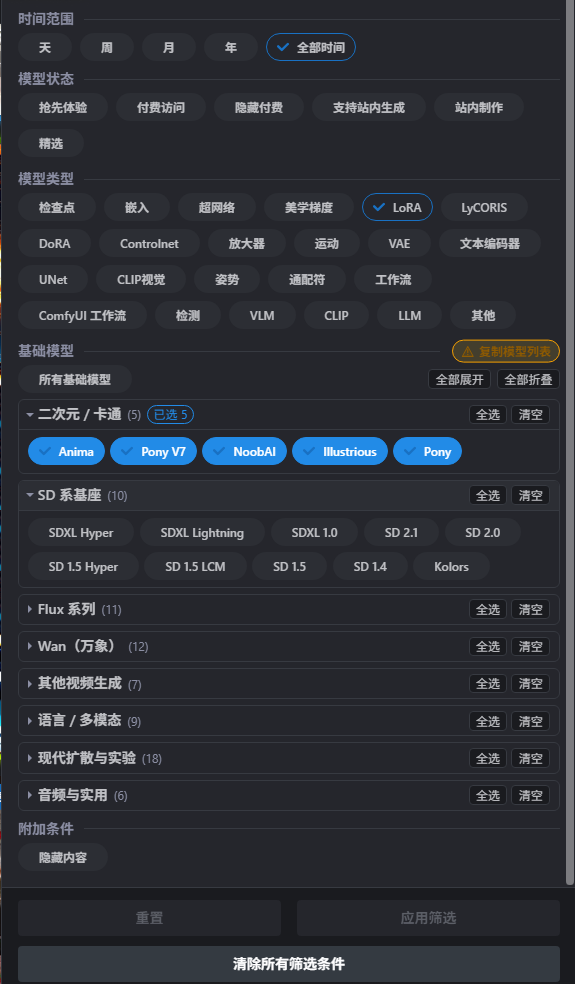

# Civitai Base Model Chips (Categorized)

Replaces Civitai's `Base model` dropdown with collapsible, time-ordered category groups of chip filters.

把 Civitai 的「基础模型」下拉框换成分组折叠的胶囊筛选：79 个基础模型收进 8 个分类，组内新模型在左，支持按分类一键全选。



## Attribution / 来源声明

This project is a fork of **[lericogit/civitai-base-model-chips](https://github.com/lericogit/civitai-base-model-chips)** (v1.6.0, MIT). The original chip-replacement idea, the hidden-dropdown handling, the `Copy model list` button, the `MODE` / `BLACKLIST` / `WHITELIST` visual filters and the SPA re-render handling all come from the upstream project. Copyright of those parts belongs to **lericogit**.

本项目基于 **lericogit** 的 [civitai-base-model-chips](https://github.com/lericogit/civitai-base-model-chips)（v1.6.0，MIT 许可）修改而成。胶囊替换下拉框、隐藏下拉框保留、`Copy model list` 按钮、黑白名单过滤、SPA 重绘处理等原有能力全部来自上游，版权归原作者 **lericogit** 所有。本分支只在其基础上增加了分类分组与组内排序，并按 MIT 要求保留原版权声明（见 [LICENSE](./LICENSE)）。

If you only want the original flat chip list, install the upstream script instead. Do **not** install both at the same time — they target the same DOM nodes.

## What's new in this fork / 本分支的改动

- **Classification / 分类折叠** — the 79 base models are grouped into 8 collapsible categories (anime, SD bases, Flux, Wan, other video, language/multimodal, modern diffusion, audio & utility). Collapsed by default, with a toolbar for expand-all / collapse-all.
- **Time-ordered inside each group / 组内左新右旧** — `SD 3.5` sits left of `SDXL 1.0`, `Flux.3` left of `Flux.2 D`, `Wan Video 3.0` left of `Wan Video 2.2`.
- **Per-category select / 按分类全选** — `全选` / `清空` on each category header selects or clears that whole group. It only writes the filter state; the site's own `Apply filters` button still does the actual filtering.
- **Rule-based, not hardcoded / 靠规则不靠硬编码** — a model is placed by regex patterns plus an explicit order list, so new Civitai base models land in the right category automatically and sort after the ones already listed.

## Categories / 分类一览

| Category / 分类 | Models / 包含 |
| --- | --- |
| 二次元 / 卡通 | Anima, Pony V7, NoobAI, Illustrious, Pony |
| SD 系基座 | SD 3.5, SDXL Hyper, SDXL Lightning, SDXL 1.0, SD 2.1, SD 2.0, SD 1.5 Hyper, SD 1.5 LCM, SD 1.5, SD 1.4, Kolors |
| Flux 系列 | Flux.3, Flux 3 Video, Flux.2 D, Flux.2 Klein 9B / 9B-base / 4B / 4B-base, Flux.1 Kontext, Flux.1 Krea, Flux.1 D, Flux.1 S |
| Wan（万象） | Wan Video 3.0 / 2.7 / 2.5 T2V / 2.5 I2V / 2.2 T2V-A14B / 2.2 I2V-A14B / 2.2 TI2V-5B / 14B i2v 720p / 14B i2v 480p / 14B t2v / 1.3B t2v, Wan Image 2.7 |
| 其他视频生成 | LTXV 2.5, LTXV 2.3, LTXV2, LTXV, Hunyuan Video, Mochi, CogVideoX |
| 语言 / 多模态 | Qwen 3, Qwen 2.1, Qwen 2, Qwen, HiDream-O1, HiDream, Grok, Hunyuan 1, Ernie |
| 现代扩散与实验 | Ideogram 4.0, Krea 2, PixArt E / a, Chroma, AuraFlow, Lumina, MageFlow, Reve, Muse Image, ZImageTurbo, ZImageBase, Ming Image Design 0.1 / Layer 0.1, Lens, MAI, Boogu, HappyHorse |
| 音频与实用 | MiniMax Music 3, MiniMax H3, ACE Audio, Sonilo, Upscaler, Other |

Anything not matched by a rule falls into `未分类`. Only models that Civitai actually offers are rendered — the list above is the script's ordering table, so a category can show fewer chips than listed here.

## Install / 安装

1. Install [Tampermonkey](https://www.tampermonkey.net/) (or Violentmonkey / ScriptCat).
2. Open the raw script and confirm the install prompt:

   <https://raw.githubusercontent.com/LingYingNX/civitai-base-model-chips-categorized/main/civitai-base-model-chips.user.js>

3. Open <https://civitai.com/models> — the `基础模型` section now shows collapsible categories.

Updates are checked automatically through `@updateURL`.

## Usage / 使用

- Click a category header to expand or collapse it.
- `全选` on a header selects every model in that category; `清空` unselects them.
- Individual chips toggle one model, same as before.
- `全部展开` / `全部折叠` in the toolbar act on all categories at once.
- `所有基础模型` clears the current selection.
- `复制模型列表` copies the live base-model list as a ready-to-paste `const ALL_BASE_MODELS = [...]`.
- Nothing applies until you press the site's own `应用筛选`.

## Configuration / 配置

Everything lives in the `USER CONFIG` block near the top of the script:

```js
const MODEL_CATEGORIES = [
  {
    name: '分类名',
    patterns: [/^Prefix/i],   // used to classify models that are not in `order`
    order: ['Model A', 'Model B'], // explicit left-to-right order (newest first)
  },
  // ...
];
```

- Add a category by appending an object — its position in the array is its display position.
- Order inside `order` is exactly the left-to-right order of the chips.
- `UNCATEGORIZED_NAME` sets the label for unmatched models.

## Compatibility / 兼容性

- `https://civitai.com/*`, `https://civitai.red/*`, `https://civitai.green/*`
- Tested with Tampermonkey; needs no `@grant`, runs at `document-idle`.
- The theme follows Civitai's own Mantine variables, so it works in both light and dark mode.

## License / 许可证

MIT — see [LICENSE](./LICENSE). Original work copyright (c) 2026 [lericogit](https://github.com/lericogit); modifications copyright (c) 2026 [LingYingNX](https://github.com/LingYingNX).
